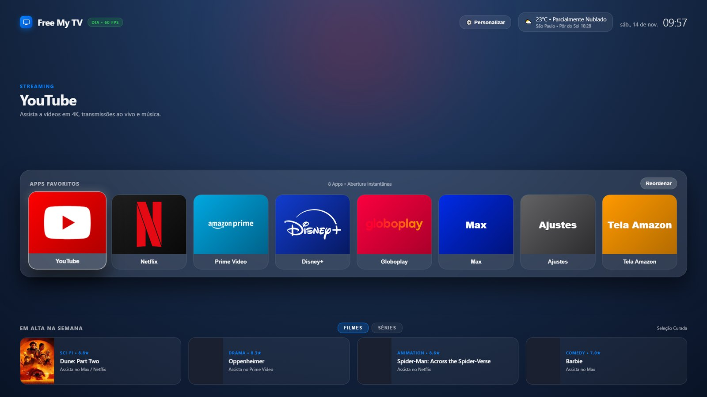
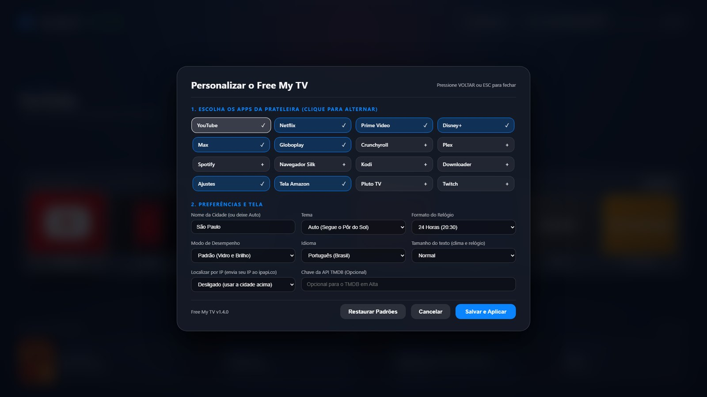
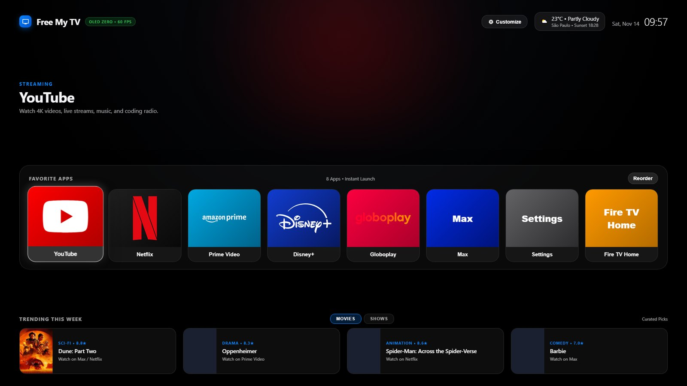
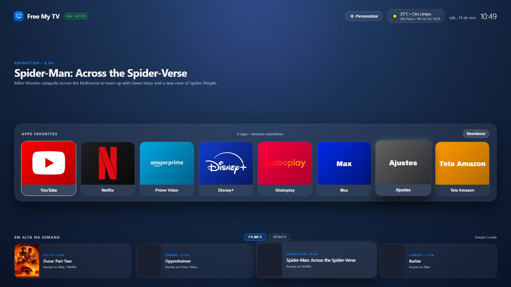
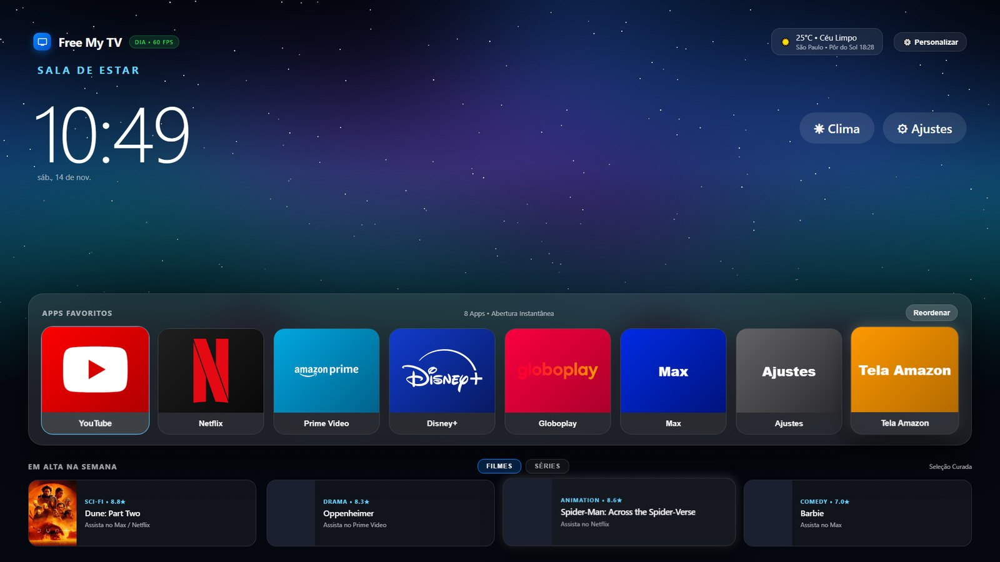
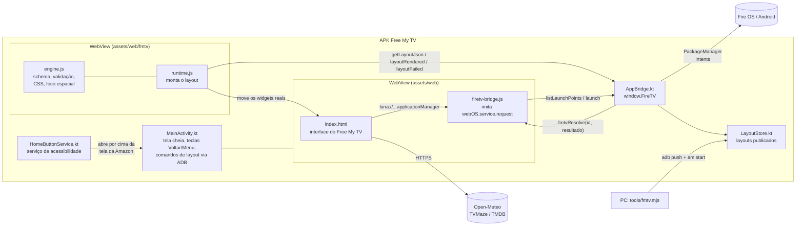
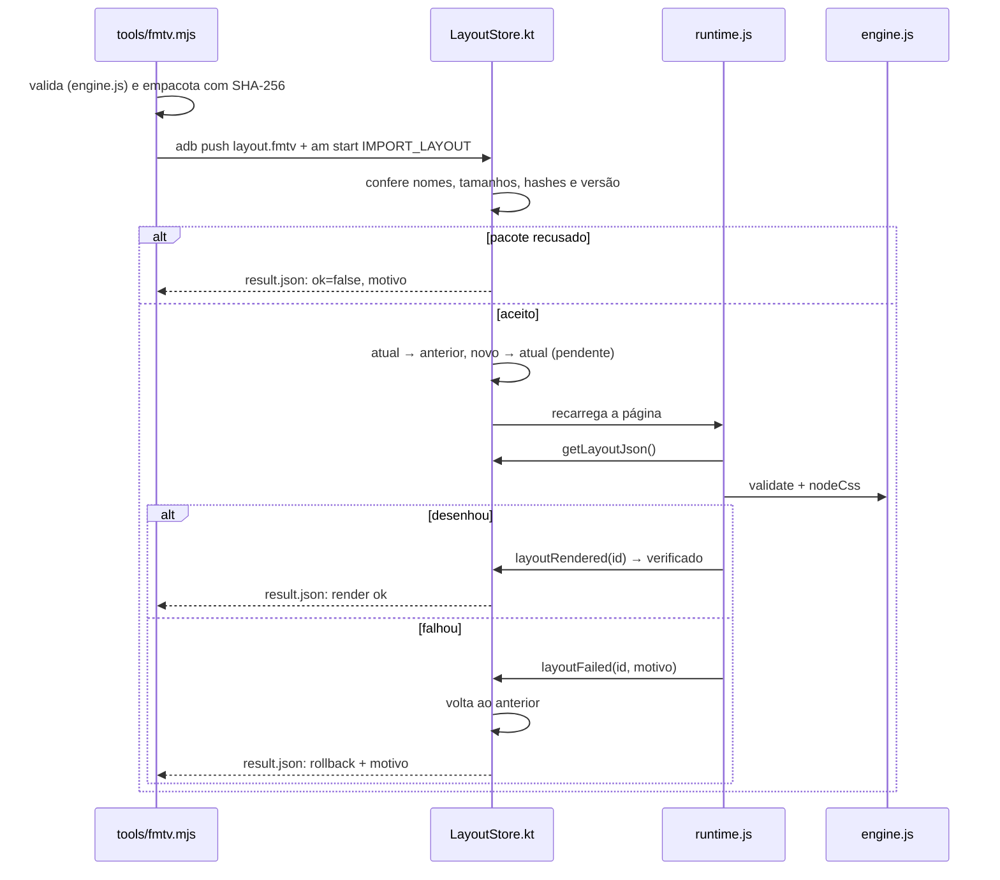
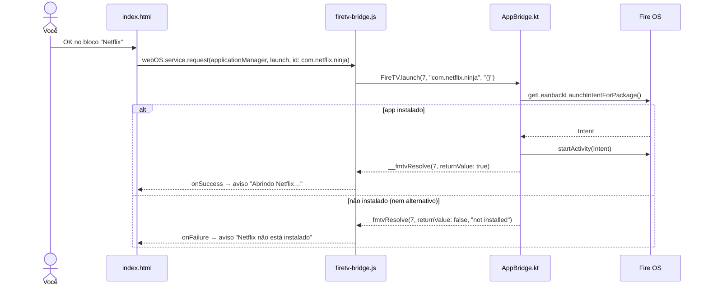
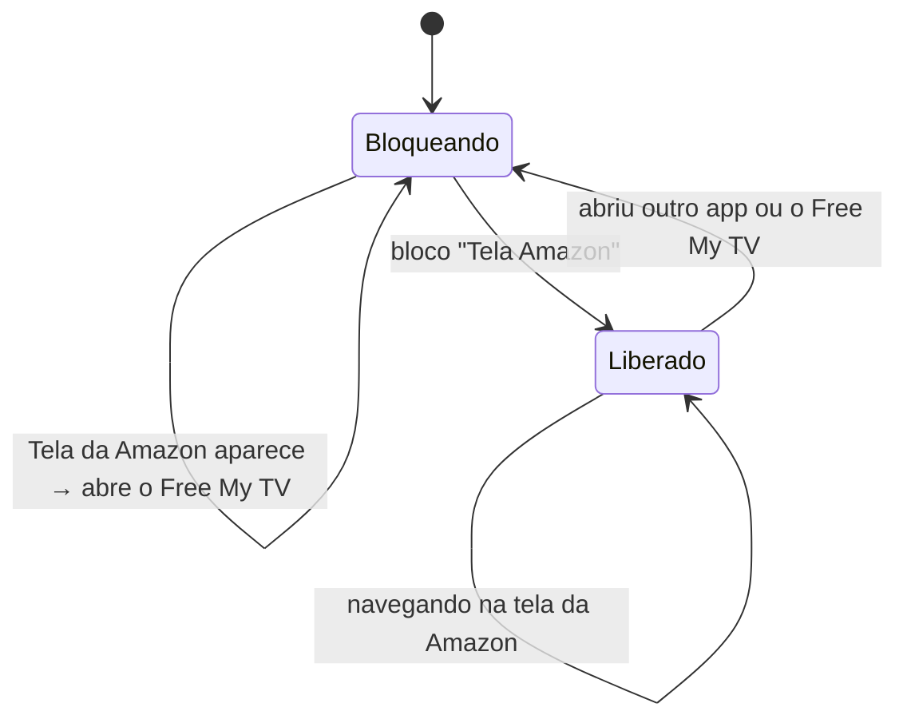

<div align="center">


# Free My TV para Fire TV

**Uma tela inicial rápida, limpa e sem anúncios para o Amazon Fire TV Stick.**

Seus apps de streaming numa prateleira de vidro, clima ao vivo que acompanha o pôr do sol e os filmes e séries em alta da semana.

[Telas](#-telas) · [Instalação](#-instalação) · [Botão Home](#-fazer-o-botão-home-abrir-o-free-my-tv) · [Layouts](#-layouts-personalizados) · [Como funciona](#%EF%B8%8F-como-funciona) · [Arquitetura](#-arquitetura) · [Desenvolvimento](#-desenvolvimento) · [Roadmap](#%EF%B8%8F-roadmap-free-my-tv-studio)

</div>

---

Este projeto adapta para o Fire TV o [**Free My TV for LG webOS**](https://github.com/danielthejoker18/FreeMyTvWebOS), de Daniel (licença MIT). A interface é a mesma do original. O que muda é a camada que conversa com o aparelho: no LG ela usa os serviços do webOS e aqui usa o Android, que é a base do Fire OS.

> **Status:** em desenvolvimento.
> - O APK compila e os testes automáticos passam: 19 testes do motor de layout e os cenários do runtime no Chrome headless.
> - Nada foi testado num Fire TV de verdade ainda. As telas abaixo vêm da interface rodando no Chrome, com uma simulação dos apps instalados.
> - Se algo não funcionar no seu aparelho, abra uma *issue* dizendo o modelo e a versão do Fire OS.

## 📺 Telas



<table>
<tr>
<td width="33%"><br><sub><b>Personalizar:</b> escolha os apps da prateleira, a cidade do clima, o tema e o idioma.</sub></td>
<td width="33%"><br><sub><b>Clima e Sol:</b> previsão hora a hora, nascer e pôr do sol (Open-Meteo).</sub></td>
<td width="33%"><br><sub><b>Tema OLED</b> (preto puro) com a interface em inglês.</sub></td>
</tr>
</table>

## ✨ O que tem

- **Sem anúncios:** nada de banners, linhas patrocinadas ou propaganda.
- **Prateleira de apps:** até 8 favoritos. Ela detecta os apps instalados e mostra o banner oficial de cada um.
- **Blocos do Fire TV:** **Ajustes** abre as configurações do aparelho e **Tela Amazon** volta à tela inicial original, onde fica a loja de apps.
- **Clima ao vivo:** o fundo muda de cor do dia para o pôr do sol e depois para a noite.
- **Em alta:** filmes e séries da semana. Usa o TMDB se você informar uma chave, ou o TVMaze sem chave nenhuma.
- **Trailers:** um clique abre o trailer direto no YouTube.
- **5 idiomas:** português, inglês, espanhol, alemão e francês. Segue o idioma do Fire TV.
- **Protetor de tela:** relógio flutuante em fundo preto.
- **Botão Home opcional:** veja [abaixo](#-fazer-o-botão-home-abrir-o-free-my-tv).

## ✅ Compatibilidade

| Aparelho | Funciona? |
|---|---|
| Fire TV Stick, Lite, 4K e 4K Max (Fire OS 5, 6, 7 e 8) | ✅ Sim |
| Fire TV Cube | ✅ Sim |
| Outras TV boxes Android TV / Google TV | ✅ Sim (sem o bloco "Tela Amazon") |
| Fire TV com **Vega OS** (ex.: Fire TV Stick 4K Select) | ❌ Não. O Vega OS não é Android e não instala APK. |

Para ver a versão do seu aparelho: **Configurações → Meu Fire TV → Sobre**.

## 📥 Instalação

### Opção 1: pelo app Downloader (sem PC)

1. No Fire TV, abra **Configurações → Meu Fire TV → Opções do desenvolvedor**.
   Se essa opção não aparecer, entre em **Sobre** e clique 7 vezes em cima do nome do aparelho.
2. Instale o app **Downloader** pela loja da Amazon.
3. Em **Opções do desenvolvedor → Instalar apps desconhecidos**, ative o **Downloader**.
4. Abra o Downloader e digite este endereço:
   ```
   https://github.com/FellipeLyra/FreeMyTvFireTV/releases/latest/download/FreeMyTvFireTV.apk
   ```
5. Clique em **Instalar** e depois em **Abrir**.

O Free My TV aparece em **Seus apps e canais**. Para achá-lo mais rápido, segure o botão Home, vá em **Apps** e mova-o para a primeira linha.

### Opção 2: pelo PC com ADB

1. No Fire TV: **Opções do desenvolvedor → Depuração ADB → Ativado**. Veja o IP em **Sobre → Rede**.
2. No PC, com o [platform-tools](https://developer.android.com/tools/releases/platform-tools) instalado:
   ```
   adb connect IP_DO_FIRETV
   adb install -r FreeMyTvFireTV.apk
   ```
   Na primeira conexão, aceite a autorização que aparece na TV.

### Atualizar

Instale o APK novo por cima do antigo, pelos mesmos passos. Suas preferências continuam salvas.

## 🏠 Fazer o botão Home abrir o Free My TV

O Fire OS não deixa trocar a tela inicial padrão. O Free My TV contorna isso com um **serviço de acessibilidade** opcional: quando a tela da Amazon aparece, ele abre o Free My TV no lugar.

O serviço **só verifica qual app está na frente**. Ele não lê nada do que aparece na tela.

**Pelo controle:** vá em **Configurações → Acessibilidade** e ative **Free My TV: botão Home**.

Nem todas as versões do Fire OS mostram serviços de apps instalados por fora da loja. Se o seu não mostrar, use o ADB:

```
adb shell settings put secure enabled_accessibility_services io.github.fellipelyra.freemytv/io.github.fellipelyra.freemytv.HomeButtonService
adb shell settings put secure accessibility_enabled 1
```

- Para chegar à tela da Amazon (loja de apps, por exemplo), use o bloco **Tela Amazon**. Ele libera a tela original até você abrir outro app.
- Para desligar de vez, desative o serviço em Acessibilidade ou rode `adb shell settings put secure enabled_accessibility_services ""`.

> Atualizações do Fire OS às vezes desligam serviços de acessibilidade. Se o Home voltar a abrir a tela da Amazon, é só ativar de novo.

## 🎮 Controle remoto

| Botão | O que faz |
|---|---|
| Setas | Navegam entre os apps, as abas e os filmes |
| OK | Abre o app ou o item selecionado |
| Voltar | Fecha janelas e menus. Na tela principal não faz nada, porque esta é a tela inicial. |
| ≡ (menu) | Abre **Personalizar** |

## 🎨 Layouts personalizados

A tela inicial pode ser **remontada por um arquivo de layout**, sem recompilar o app. No layout você define:
- **stacks** horizontais e verticais (auto layout) e **posicionamento absoluto** com constraints;
- cores e tokens, imagens de fundo, textos, botões e animações de entrada e de foco;
- onde ficam os widgets do launcher: prateleira de apps, clima, relógio, data e filmes em alta.

O formato completo está em **[docs/layouts.md](docs/layouts.md)**. Este é o formato que o futuro **Free My TV Studio** (editor visual para PC) vai gerar; veja o [Roadmap](#%EF%B8%8F-roadmap-free-my-tv-studio). Por enquanto os layouts são escritos à mão e publicados pela CLI.

<table>
<tr>
<td width="50%"><br><sub><b><code>examples/layouts/classic.json</code>:</b> reproduz a tela original usando stacks.</sub></td>
<td width="50%"><br><sub><b><code>examples/layouts/cinema.json</code>:</b> imagem de fundo, relógio grande e "Sala de estar" posicionados livremente, botões de atalho e a prateleira e os filmes em alta numa stack embaixo.</sub></td>
</tr>
</table>

### Publicar um layout no Fire TV (ADB)

Requisitos: Node 18+ e o [platform-tools](https://developer.android.com/tools/releases/platform-tools) (`adb`), com a **Depuração ADB** ligada no Fire TV.

```
node tools/fmtv.mjs validate examples/layouts/cinema.json             # confere o layout
node tools/fmtv.mjs publish  examples/layouts/cinema.json --device 192.168.0.50
```

O `publish` faz o seguinte:
1. conecta no aparelho e confere se este PC está autorizado e se o Free My TV está instalado;
2. valida o layout e monta o pacote `.fmtv`, com o SHA-256 de cada imagem;
3. envia o pacote e pede ao app para importar;
4. espera a TV **confirmar que desenhou** o layout.

Se o layout falhar na TV, o app volta sozinho ao layout anterior e o comando mostra o motivo.

| Comando | O que faz |
|---|---|
| `node tools/fmtv.mjs pack <layout.json>` | Gera o `.fmtv` sem enviar |
| `node tools/fmtv.mjs inspect <pacote.fmtv>` | Lista e valida o conteúdo de um pacote |
| `node tools/fmtv.mjs devices` | Lista os aparelhos que o `adb` enxerga |
| `node tools/fmtv.mjs rollback --device IP` | Volta ao layout anterior |
| `node tools/fmtv.mjs reset --device IP` | Volta à tela original (o layout fica guardado como anterior) |
| `node tools/fmtv.mjs status --device IP` | Mostra o layout ativo e o anterior |

As imagens de um layout ficam na pasta `<nome-do-layout>-assets/`, ao lado do `.json`. Também dá para indicar outra com `--assets`.

### Sempre dá para voltar

- **Pela TV:** **≡** (Personalizar) → **Layout padrão**. A tecla ≡ é do app, não do layout, então nenhum layout consegue removê-la.
- **Pelo PC:** `node tools/fmtv.mjs reset`.
- **Automático:** se um layout é inválido ou não chega a aparecer na tela, o app volta ao anterior sozinho.
- **Sem layout publicado**, a tela é exatamente a original.

## ⚙️ Como funciona

A interface do Free My TV é uma página web (HTML, CSS e JavaScript) feita para televisores. No LG ela roda dentro do webOS e chama os serviços dele para listar e abrir apps, por exemplo com `webOS.service.request('luna://com.webos.applicationManager', { method: 'launch' })`.

Aqui, a mesma página roda dentro de um **WebView** do Android, num app em tela cheia. Um arquivo pequeno, o `firetv-bridge.js`, cria um objeto `webOS` falso com a mesma forma do original. Quando a página pede para listar ou abrir apps, ele repassa o pedido ao código Kotlin, que usa o Android de verdade.

Por isso a interface original quase não muda: o script `scripts/sync_web.py` só troca o catálogo de apps do LG pelos pacotes do Fire TV, esconde a seção de HDMI e ajusta algumas traduções.

## 🧩 Arquitetura

### Componentes



| Arquivo | Papel |
|---|---|
| [`app/src/main/assets/web/index.html`](app/src/main/assets/web/index.html) | Interface do Free My TV, adaptada pelo `sync_web.py` |
| [`app/src/main/assets/web/firetv-bridge.js`](app/src/main/assets/web/firetv-bridge.js) | Implementa `webOS.service.request` em cima da ponte Android |
| [`MainActivity.kt`](app/src/main/java/io/github/fellipelyra/freemytv/MainActivity.kt) | WebView em tela cheia servida por `https://appassets.androidplatform.net`, teclas Voltar e Menu, atualiza a lista de apps ao voltar |
| [`AppBridge.kt`](app/src/main/java/io/github/fellipelyra/freemytv/AppBridge.kt) | Lista os apps (com banner/ícone em `data:` URL) e abre apps, trailers e configurações |
| [`HomeButtonService.kt`](app/src/main/java/io/github/fellipelyra/freemytv/HomeButtonService.kt) | Serviço opcional que troca a tela da Amazon pelo Free My TV |
| [`fmtv/engine.js`](app/src/main/assets/web/fmtv/engine.js) | Motor de layout compartilhado (TV, CLI, testes e futuro Studio): schema, validação, migrações, geração de CSS, navegação espacial |
| [`fmtv/runtime.js`](app/src/main/assets/web/fmtv/runtime.js) | Monta o layout publicado sobre a página, move os widgets reais, cuida das setas e informa sucesso ou falha ao app |
| [`LayoutStore.kt`](app/src/main/java/io/github/fellipelyra/freemytv/LayoutStore.kt) | Importação segura dos pacotes, troca atômica, estado pendente/verificado, rollback automático, log |
| [`tools/fmtv.mjs`](tools/fmtv.mjs) | CLI: validar, empacotar, inspecionar e publicar por ADB |
| [`scripts/sync_web.py`](scripts/sync_web.py) | Copia a interface do projeto original e aplica as mudanças para o Fire TV (mantém `fmtv/` e `firetv-bridge.js`) |

### Publicando um layout



### Abrindo um app



Para alguns serviços existem pacotes alternativos que são tentados em ordem. O YouTube, por exemplo, tenta o app oficial do Fire TV, depois o YouTube para Android TV e depois o SmartTube.

### Botão Home



### Listando os apps instalados

O `AppBridge` procura atividades com `LEANBACK_LAUNCHER` (apps de TV) e `LAUNCHER`, ignora o próprio Free My TV e devolve uma lista no formato do `listLaunchPoints` do webOS. Cada app vem com o **banner** de TV (320×180), ou com o ícone quando não tem banner, já convertido em imagem `data:`. Os apps de sistema da Amazon que não estão no catálogo ficam fora da lista, para não poluir a tela Personalizar.

## 🛠 Desenvolvimento

### Requisitos

- JDK 17
- Android SDK 34
- Gradle 8.9

### Compilar

```
gradle assembleRelease
```

O APK sai em `app/build/outputs/apk/release/`. Sem as variáveis de assinatura (`FMTV_KEYSTORE`, `FMTV_KEYSTORE_PASSWORD`), ele é assinado com a chave de debug, o que basta para testar.

### Atualizar a interface a partir do projeto original

```
git clone https://github.com/danielthejoker18/FreeMyTvWebOS.git ../FreeMyTvWebOS
python scripts/sync_web.py ../FreeMyTvWebOS
```

Cada mudança do script precisa encontrar exatamente o trecho esperado. Se o projeto original mudar algo, o script para com um erro em vez de gerar uma interface quebrada.

### Testes

```
node --test tools/test/          # motor de layout e formato do pacote (19 testes)
node tools/browser-test.mjs      # runtime no Chrome headless (precisa do Chrome ou Edge)
```

O teste de navegador serve a página como o APK faz, troca a ponte Android por uma simulação que registra as chamadas e confere quatro cenários:
- **sem layout:** a tela original fica intacta;
- **classic e cinema:** o layout é montado, os widgets reais são movidos, a renderização é confirmada ao app, o foco inicial cai no primeiro app e as setas navegam sem sair do layout;
- **layout inválido:** a tela original continua e a falha é informada ao app, para o rollback.

Com `--shots PASTA` ele também salva prints. **É uma simulação em navegador, não um teste no Fire TV.**

### Testar a interface no navegador

Sirva a pasta `app/src/main/assets/web` com qualquer servidor local (por exemplo, `python -m http.server`) e abra no Chrome em 1920×1080. Sem a ponte Android a página entra no modo prévia: mostra tudo, mas não abre apps.

## 🗺️ Roadmap: Free My TV Studio

O objetivo é um editor visual para PC (no estilo de ferramentas de design de interface) que gera os layouts acima e os publica no Fire TV.

| Fase | O que entra | Situação |
|---|---|---|
| 1. Auditoria e arquitetura | Mapear telas e widgets; schema v1; contratos entre editor, TV e publicação | ✅ Feito ([docs/layouts.md](docs/layouts.md)) |
| 2. Runtime e vertical slice | Motor compartilhado, runtime na TV, stacks e posicionamento absoluto, importação segura, rollback, CLI e ADB | ✅ Feito. APK compila e os testes automáticos passam; **falta validar num Fire TV** |
| 3. Studio desktop | App de PC (Tauri + React + TypeScript): canvas 1920×1080, camadas, propriedades, drag and drop, desfazer/refazer, salvar projeto | ⏳ Próxima |
| 4. Biblioteca de blocos | Mais componentes (carrossel, grade, banner, ícones, gradientes prontos) | ⏳ |
| 5. Todas as telas | Clima, Personalizar, protetor de tela, avisos e modais no runtime | ⏳ (o schema já aceita essas páginas) |
| 6. Prévia e controle virtual | Prévia no Studio usando o próprio runtime e simulador de controle remoto com a mesma navegação | ⏳ |
| 7. Publicação ADB no Studio | Descoberta de aparelhos, envio, rollback e histórico pelo editor (a base já está em `tools/lib/adb.mjs`) | ⏳ |
| 8. Publicação pela internet | Backend com pareamento por código, tokens por aparelho e distribuição por HTTPS | ⏳ |
| 9. Refinamento | Desempenho em aparelhos fracos, testes no aparelho, instalador do Studio | ⏳ |

## ⚠️ Limitações

- **Sem troca de entrada HDMI:** o stick já está plugado no HDMI da TV.
- **O botão Home depende de acessibilidade:** a Amazon pode mudar isso numa atualização.
- **Vega OS não é suportado:** esses aparelhos não rodam apps Android.
- **Precisa de internet** para o clima e para os filmes em alta. A prateleira de apps e o layout publicado funcionam offline.
- **Layouts:** por enquanto o runtime só aplica a tela inicial. Clima, Personalizar e protetor de tela seguem o visual original, exceto pelas cores dos tokens.

## 📄 Licença e créditos

- Licença MIT. Veja [LICENSE](LICENSE).
- Interface original: [Free My TV for LG webOS](https://github.com/danielthejoker18/FreeMyTvWebOS), de Daniel.
- Logotipos das marcas: [Simple Icons](https://simpleicons.org/) (CC0). Veja `app/src/main/assets/web/assets/brands/SOURCES.md`.
- Clima: [Open-Meteo](https://open-meteo.com/). Séries: [TVMaze](https://www.tvmaze.com/api). Filmes: [TMDB](https://www.themoviedb.org/) (opcional).

Free My TV não tem relação com a Amazon nem com a LG. Fire TV é marca da Amazon.com, Inc.
