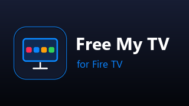
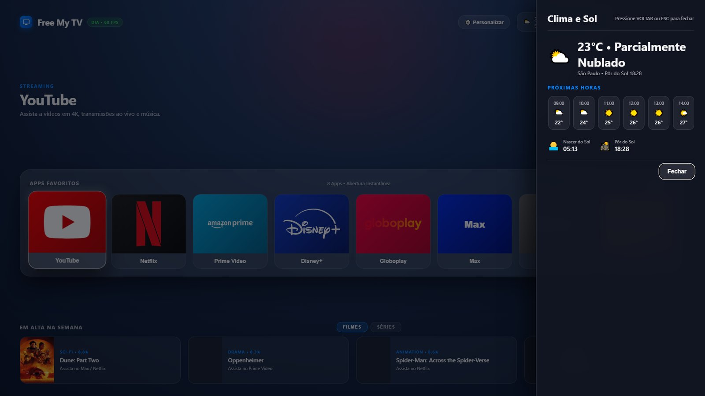
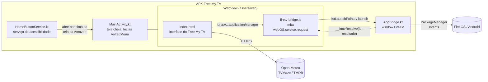
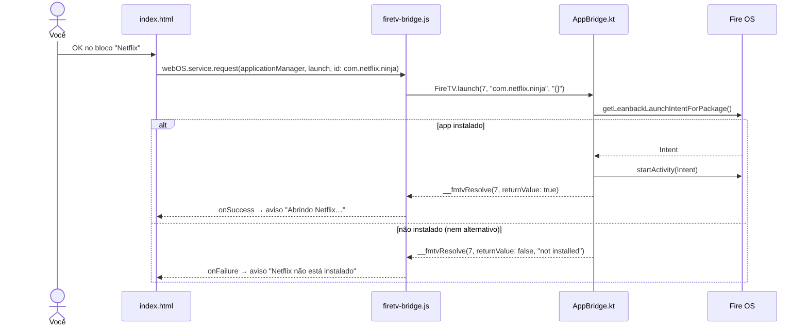
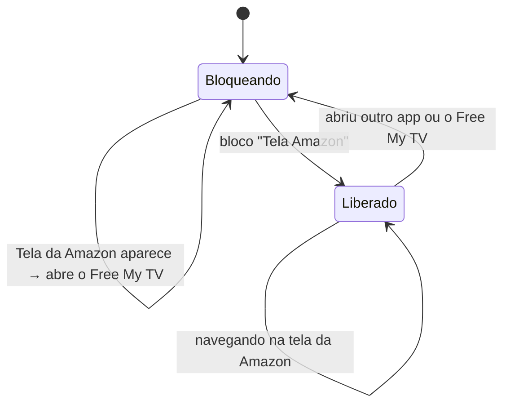

<div align="center">



# Free My TV para Fire TV

**Uma tela inicial rápida, limpa e sem anúncios para o Amazon Fire TV Stick.**

Seus apps de streaming numa prateleira de vidro, clima ao vivo que acompanha o pôr do sol e os filmes e séries em alta da semana.

[Telas](#-telas) · [Instalação](#-instalação) · [Botão Home](#-fazer-o-botão-home-abrir-o-free-my-tv) · [Como funciona](#%EF%B8%8F-como-funciona) · [Arquitetura](#-arquitetura) · [Desenvolvimento](#-desenvolvimento)

</div>

---

Este projeto adapta para o Fire TV o [**Free My TV for LG webOS**](https://github.com/danielthejoker18/FreeMyTvWebOS), de Daniel (licença MIT). A interface é a mesma do original. O que muda é a camada que conversa com o aparelho: no LG ela usa os serviços do webOS e aqui usa o Android, que é a base do Fire OS.

> **Status:** primeira versão. O app ainda não foi testado num Fire TV de verdade. As telas abaixo vêm da interface rodando num navegador, com uma simulação dos apps instalados. Se algo não funcionar no seu aparelho, abra uma *issue* dizendo o modelo e a versão do Fire OS.

## 📺 Telas


<table>
<tr>
<td width="33%"><br><sub><b>Personalizar:</b> escolha os apps da prateleira, a cidade do clima, o tema e o idioma.</sub></td>
<td width="33%"><br><sub><b>Clima e Sol:</b> previsão hora a hora, nascer e pôr do sol (Open-Meteo).</sub></td>
<td width="33%"><br><sub><b>Tema OLED</b> (preto puro) com a interface em inglês.</sub></td>
</tr>
</table>

## ✨ O que tem

- **Sem anúncios:** nada de banners, linhas patrocinadas ou propaganda.
- **Prateleira de apps:** até 8 favoritos. Ela detecta os apps instalados e mostra o banner oficial de cada um.
- **Blocos do Fire TV:** **Ajustes** abre as configurações do aparelho e **Tela Amazon** volta à tela inicial original, onde fica a loja de apps.
- **Clima ao vivo:** o fundo muda de cor do dia para o pôr do sol e depois para a noite.
- **Em alta:** filmes e séries da semana. Usa o TMDB se você informar uma chave, ou o TVMaze sem chave nenhuma.
- **Trailers:** um clique abre o trailer direto no YouTube.
- **5 idiomas:** português, inglês, espanhol, alemão e francês. Segue o idioma do Fire TV.
- **Protetor de tela:** relógio flutuante em fundo preto.
- **Botão Home opcional:** veja [abaixo](#-fazer-o-botão-home-abrir-o-free-my-tv).

## ✅ Compatibilidade

| Aparelho | Funciona? |
|---|---|
| Fire TV Stick, Lite, 4K e 4K Max (Fire OS 5, 6, 7 e 8) | ✅ Sim |
| Fire TV Cube | ✅ Sim |
| Outras TV boxes Android TV / Google TV | ✅ Sim (sem o bloco "Tela Amazon") |
| Fire TV com **Vega OS** (ex.: Fire TV Stick 4K Select) | ❌ Não. O Vega OS não é Android e não instala APK. |

Para ver a versão do seu aparelho: **Configurações → Meu Fire TV → Sobre**.

## 📥 Instalação

### Opção 1: pelo app Downloader (sem PC)

1. No Fire TV, abra **Configurações → Meu Fire TV → Opções do desenvolvedor**.
   Se essa opção não aparecer, entre em **Sobre** e clique 7 vezes em cima do nome do aparelho.
2. Instale o app **Downloader** pela loja da Amazon.
3. Em **Opções do desenvolvedor → Instalar apps desconhecidos**, ative o **Downloader**.
4. Abra o Downloader e digite este endereço:
   ```
   https://github.com/FellipeLyra/FreeMyTvFireTV/releases/latest/download/FreeMyTvFireTV.apk
   ```
5. Clique em **Instalar** e depois em **Abrir**.

O Free My TV aparece em **Seus apps e canais**. Para achá-lo mais rápido, segure o botão Home, vá em **Apps** e mova-o para a primeira linha.

### Opção 2: pelo PC com ADB

1. No Fire TV: **Opções do desenvolvedor → Depuração ADB → Ativado**. Veja o IP em **Sobre → Rede**.
2. No PC, com o [platform-tools](https://developer.android.com/tools/releases/platform-tools) instalado:
   ```
   adb connect IP_DO_FIRETV
   adb install -r FreeMyTvFireTV.apk
   ```
   Na primeira conexão, aceite a autorização que aparece na TV.

### Atualizar

Instale o APK novo por cima do antigo, pelos mesmos passos. Suas preferências continuam salvas.

## 🏠 Fazer o botão Home abrir o Free My TV

O Fire OS não deixa trocar a tela inicial padrão. O Free My TV contorna isso com um **serviço de acessibilidade** opcional: quando a tela da Amazon aparece, ele abre o Free My TV no lugar.

O serviço **só verifica qual app está na frente**. Ele não lê nada do que aparece na tela.

**Pelo controle:** vá em **Configurações → Acessibilidade** e ative **Free My TV: botão Home**.

Nem todas as versões do Fire OS mostram serviços de apps instalados por fora da loja. Se o seu não mostrar, use o ADB:

```
adb shell settings put secure enabled_accessibility_services io.github.fellipelyra.freemytv/io.github.fellipelyra.freemytv.HomeButtonService
adb shell settings put secure accessibility_enabled 1
```

- Para chegar à tela da Amazon (loja de apps, por exemplo), use o bloco **Tela Amazon**. Ele libera a tela original até você abrir outro app.
- Para desligar de vez, desative o serviço em Acessibilidade ou rode `adb shell settings put secure enabled_accessibility_services ""`.

> Atualizações do Fire OS às vezes desligam serviços de acessibilidade. Se o Home voltar a abrir a tela da Amazon, é só ativar de novo.

## 🎮 Controle remoto

| Botão | O que faz |
|---|---|
| Setas | Navegam entre os apps, as abas e os filmes |
| OK | Abre o app ou o item selecionado |
| Voltar | Fecha janelas e menus. Na tela principal não faz nada, porque esta é a tela inicial. |
| ≡ (menu) | Abre **Personalizar** |

## ⚙️ Como funciona

A interface do Free My TV é uma página web (HTML, CSS e JavaScript) feita para televisores. No LG ela roda dentro do webOS e chama os serviços dele para listar e abrir apps, por exemplo com `webOS.service.request('luna://com.webos.applicationManager', { method: 'launch' })`.

Aqui, a mesma página roda dentro de um **WebView** do Android, num app em tela cheia. Um arquivo pequeno, o `firetv-bridge.js`, cria um objeto `webOS` falso com a mesma forma do original. Quando a página pede para listar ou abrir apps, ele repassa o pedido ao código Kotlin, que usa o Android de verdade.

Por isso a interface original quase não muda: o script `scripts/sync_web.py` só troca o catálogo de apps do LG pelos pacotes do Fire TV, esconde a seção de HDMI e ajusta algumas traduções.

## 🧩 Arquitetura

### Componentes



| Arquivo | Papel |
|---|---|
| [`app/src/main/assets/web/index.html`](app/src/main/assets/web/index.html) | Interface do Free My TV, adaptada pelo `sync_web.py` |
| [`app/src/main/assets/web/firetv-bridge.js`](app/src/main/assets/web/firetv-bridge.js) | Implementa `webOS.service.request` em cima da ponte Android |
| [`MainActivity.kt`](app/src/main/java/io/github/fellipelyra/freemytv/MainActivity.kt) | WebView em tela cheia servida por `https://appassets.androidplatform.net`, teclas Voltar e Menu, atualiza a lista de apps ao voltar |
| [`AppBridge.kt`](app/src/main/java/io/github/fellipelyra/freemytv/AppBridge.kt) | Lista os apps (com banner/ícone em `data:` URL) e abre apps, trailers e configurações |
| [`HomeButtonService.kt`](app/src/main/java/io/github/fellipelyra/freemytv/HomeButtonService.kt) | Serviço opcional que troca a tela da Amazon pelo Free My TV |
| [`scripts/sync_web.py`](scripts/sync_web.py) | Copia a interface do projeto original e aplica as mudanças para o Fire TV |

### Abrindo um app



Para alguns serviços existem pacotes alternativos que são tentados em ordem. O YouTube, por exemplo, tenta o app oficial do Fire TV, depois o YouTube para Android TV e depois o SmartTube.

### Botão Home



### Listando os apps instalados

O `AppBridge` procura atividades com `LEANBACK_LAUNCHER` (apps de TV) e `LAUNCHER`, ignora o próprio Free My TV e devolve uma lista no formato do `listLaunchPoints` do webOS. Cada app vem com o **banner** de TV (320×180), ou com o ícone quando não tem banner, já convertido em imagem `data:`. Os apps de sistema da Amazon que não estão no catálogo ficam fora da lista, para não poluir a tela Personalizar.

## 🛠 Desenvolvimento

### Requisitos

- JDK 17
- Android SDK 34
- Gradle 8.9

### Compilar

```
gradle assembleRelease
```

O APK sai em `app/build/outputs/apk/release/`. Sem as variáveis de assinatura (`FMTV_KEYSTORE`, `FMTV_KEYSTORE_PASSWORD`), ele é assinado com a chave de debug, o que basta para testar.

### Atualizar a interface a partir do projeto original

```
git clone https://github.com/danielthejoker18/FreeMyTvWebOS.git ../FreeMyTvWebOS
python scripts/sync_web.py ../FreeMyTvWebOS
```

Cada mudança do script precisa encontrar exatamente o trecho esperado. Se o projeto original mudar algo, o script para com um erro em vez de gerar uma interface quebrada.

### Testar a interface no navegador

Sirva a pasta `app/src/main/assets/web` com qualquer servidor local (por exemplo, `python -m http.server`) e abra no Chrome em 1920×1080. Sem a ponte Android a página entra no modo prévia: mostra tudo, mas não abre apps.

## ⚠️ Limitações

- **Sem troca de entrada HDMI:** o stick já está plugado no HDMI da TV.
- **O botão Home depende de acessibilidade:** a Amazon pode mudar isso numa atualização.
- **Vega OS não é suportado:** esses aparelhos não rodam apps Android.
- **Precisa de internet** para o clima e para os filmes em alta. A prateleira de apps funciona offline.

## 📄 Licença e créditos

- Licença MIT. Veja [LICENSE](LICENSE).
- Interface original: [Free My TV for LG webOS](https://github.com/danielthejoker18/FreeMyTvWebOS), de Daniel.
- Logotipos das marcas: [Simple Icons](https://simpleicons.org/) (CC0). Veja `app/src/main/assets/web/assets/brands/SOURCES.md`.
- Clima: [Open-Meteo](https://open-meteo.com/). Séries: [TVMaze](https://www.tvmaze.com/api). Filmes: [TMDB](https://www.themoviedb.org/) (opcional).

Free My TV não tem relação com a Amazon nem com a LG. Fire TV é marca da Amazon.com, Inc.
