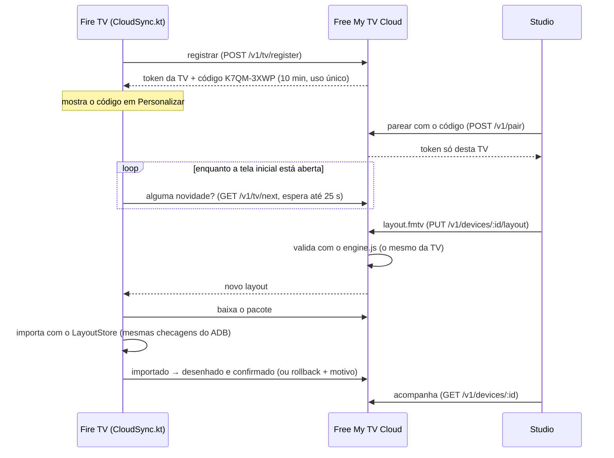

# Publicar pela internet (Free My TV Cloud)

Com o ADB, o Studio só publica numa TV da mesma rede. O **Free My TV Cloud** é um servidor pequeno que você mesmo hospeda. Com ele, o Studio publica de qualquer lugar e a TV recebe pela internet.

- Não tem dependências (Node 18+) e não usa banco de dados: tudo fica numa pasta.
- Não existe servidor "oficial": nada passa por terceiros.
- O app da TV só aceita endereços **https://**.

## Como funciona



A TV recebe os layouts **enquanto a tela inicial do Free My TV está aberta**, que é quando o app está rodando. Com a TV desligada ou em outro app, o layout fica guardado no servidor e é aplicado assim que a tela inicial abrir. O Studio avisa quando isso acontece.

## Rodar

```
node server/fmtv-cloud.mjs --port 8787 --data ./cloud-data
# ou: npm run cloud
```

| Opção | Padrão | O que é |
|---|---|---|
| `--port` / `PORT` | 8787 | Porta |
| `--host` | 0.0.0.0 | Endereço em que escuta (`127.0.0.1` atrás de um proxy) |
| `--data` / `FMTV_DATA` | `./cloud-data` | Pasta dos dados |
| `FMTV_TLS_CERT`, `FMTV_TLS_KEY` | | Certificado e chave: o próprio servidor fala HTTPS |
| `FMTV_TRUST_PROXY=1` | | Atrás de um proxy HTTPS: usa o `X-Forwarded-For` para limitar tentativas por endereço |

## HTTPS

O app da TV recusa `http://`, porque o token da TV não pode viajar sem criptografia. O jeito mais simples é um proxy que tira o certificado sozinho, como o [Caddy](https://caddyserver.com):

```
# Caddyfile
tv.seudominio.com {
    reverse_proxy 127.0.0.1:8787
}
```
```
FMTV_TRUST_PROXY=1 node server/fmtv-cloud.mjs --host 127.0.0.1 --port 8787 --data /var/lib/fmtv-cloud
```

Com o nginx, deixe `proxy_read_timeout` em 60 s ou mais, porque a TV fica esperando até 25 s em cada pedido. Também aumente `client_max_body_size` para 30m, já que um pacote pode ter até 26 MB.

## Na TV

1. Instale a versão do APK com a Fase 8.
2. **≡ (Personalizar) → 3. Publicar pela internet**. Digite o endereço (`https://tv.seudominio.com`) e escolha **Parear com o Studio**. Aparece um código de 8 letras.
3. Se não quiser digitar o endereço com o controle, use uma destas opções:
   - mande pelo PC, com o ADB, uma vez só:
     ```
     adb shell am start -n io.github.fellipelyra.freemytv/.MainActivity -a io.github.fellipelyra.freemytv.action.SET_CLOUD_SERVER --es url https://tv.seudominio.com
     ```
   - ou compile o APK com o endereço já dentro: `FMTV_CLOUD_URL=https://tv.seudominio.com gradle assembleRelease`.

Para cortar o acesso de todos os Studios: **Desparear**, na mesma tela.

## No Studio

**Dispositivo → Pela internet**: digite o endereço do servidor e o código que aparece na TV, e clique em **Parear**. A TV entra na lista e pode ser escolhida para **Publicar**, como as do ADB. Também ficam disponíveis **Voltar ao anterior**, **Tela original**, **Histórico da TV** e **Remover**, que tira o acesso deste Studio.

Para testar sem TV, em três terminais:
```
node server/fmtv-cloud.mjs --host 127.0.0.1 --data ./cloud-teste
node tools/test/fake-cloud-tv.mjs http://127.0.0.1:8787    # mostra o código
npm run dev                                                # Studio; servidor http://127.0.0.1:8787
```
O Studio aceita `http://` só para 127.0.0.1 e localhost, que é o caso de testes como este.

## Segurança

- **Tokens:** cada TV tem o seu, e cada Studio pareado recebe um token que abre só aquela TV. O servidor guarda apenas o SHA-256 dos tokens. Um token de TV não serve como token de Studio, e vice-versa.
- **Código de pareamento:** 8 caracteres de um alfabeto sem letras ambíguas (31⁸ ≈ 850 bilhões de combinações), válido por 10 minutos e só uma vez. São no máximo 30 tentativas a cada 10 minutos por endereço, e 20 registros por hora.
- **Pacotes:** o servidor valida cada pacote com o `engine.js` antes de guardar. A TV confere tudo de novo (nomes, tamanhos, SHA-256, versão do schema) e só aplica depois de desenhar com sucesso. Se falhar, volta ao anterior. Nada no pacote é executado.
- **Revogação:** **Remover** no Studio tira o acesso daquele Studio. **Desparear** na TV apaga a TV do servidor, e todos os Studios perdem o acesso.
- **CORS:** o servidor aceita pedidos de qualquer origem, porque a autenticação é sempre um token no cabeçalho `Authorization`, nunca um cookie.
- **No Studio**, os tokens ficam no armazenamento do navegador deste PC e nunca entram no arquivo do projeto.

## Dados

`cloud-data/db.json` guarda as TVs: modelo, versão do app, hashes dos tokens, código de pareamento em aberto, último resultado e histórico curto. `cloud-data/packages/` guarda o último pacote de cada TV. Para fazer backup, basta copiar a pasta. Para recomeçar do zero, apague a pasta; aí as TVs precisam parear de novo.

## API (v1)

| Quem | Rota | O que faz |
|---|---|---|
| TV | `POST /v1/tv/register` | Registra; devolve o token da TV e o código |
| TV | `GET /v1/tv/me` · `POST /v1/tv/pair-code` | Situação · novo código |
| TV | `GET /v1/tv/next?etag=&cmd=&wait=` | Espera por um layout novo ou um comando (long poll) |
| TV | `GET /v1/tv/package?etag=` | Baixa o pacote |
| TV | `POST /v1/tv/report` | Resultado: import, render, rollback, reset |
| TV | `DELETE /v1/tv` | Despareia tudo |
| Studio | `POST /v1/pair` | Troca o código por um token desta TV |
| Studio | `GET /v1/devices/:id` | Situação, último resultado e histórico |
| Studio | `PUT /v1/devices/:id/layout` | Envia um `.fmtv` (até 26 MB) |
| Studio | `POST /v1/devices/:id/command` | `rollback` ou `reset` |
| Studio | `DELETE /v1/devices/:id/pairing` | Remove o acesso deste Studio |
| Todos | `GET /v1/health` | Serviço no ar |

## Limitações

- **Ainda não testado com um Fire TV de verdade nem com um servidor público.** O fluxo inteiro é testado com o servidor real e uma TV simulada (`tools/test/fake-cloud-tv.mjs`), que faz o mesmo que o `CloudSync.kt`. O APK compila.
- **Sem contas de usuário:** quem tem o código da TV, nos 10 minutos de validade, pode parear. Por isso o código só aparece quando alguém pede, na própria TV.
- **Limites de tentativas em memória:** reiniciar o servidor zera os contadores.
- **Um processo só:** o servidor não foi feito para rodar em vários processos ao mesmo tempo com a mesma pasta.
