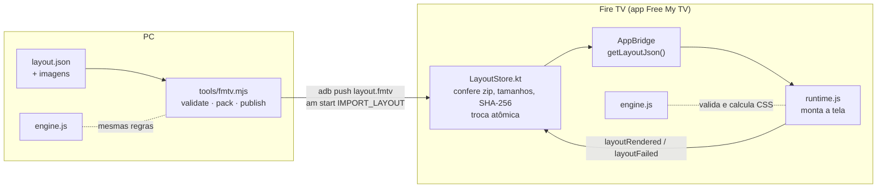

# Layouts do Free My TV: formato e funcionamento

Este documento descreve o **schema de layout v1**: o arquivo que diz como a tela inicial do Free My TV é montada. É o formato que o futuro **Free My TV Studio** vai gerar. Hoje ele pode ser escrito à mão, validado e publicado pela CLI.

O motor que lê esse formato é um arquivo só: [`app/src/main/assets/web/fmtv/engine.js`](../app/src/main/assets/web/fmtv/engine.js). O mesmo código roda no Fire TV, nos testes e na CLI, então a regra que valida um layout no PC é a mesma que o valida na TV.

## Visão geral



## Estrutura do arquivo

```json
{
  "schemaVersion": 1,
  "id": "cinema",
  "name": "Cinema",
  "tokens": { "colors": { "accent": "#64d2ff" } },
  "assets": [ { "id": "aurora", "file": "aurora.jpg" } ],
  "pages": { "home": { "root": { "id": "root", "type": "frame", "children": [] } } }
}
```

| Campo | Obrigatório | Descrição |
|---|---|---|
| `schemaVersion` | sim | Versão do formato. Este app entende a `1`. Layouts de versão maior são recusados com a mensagem "Atualize o app". |
| `id` | sim | Identificador: letras, números, `-` e `_`, começando com letra, até 64 caracteres. |
| `name` | sim | Nome exibido, até 80 caracteres. |
| `tokens` | não | Cores, espaçamentos, raios, tamanhos de fonte e família. Veja [Tokens](#tokens). |
| `assets` | não | Imagens usadas pelo layout. Veja [Assets](#assets). |
| `pages` | sim | Telas. A `home` é obrigatória. `weather`, `settings` e `screensaver` são aceitas, mas esta versão do runtime ainda não as aplica. |
| `createdAt`, `generator` | não | Metadados livres. |

Qualquer outro campo é **recusado**. Assim um erro de digitação não passa despercebido.

## Elementos (nós)

Cada elemento tem `id` (único na tela) e `type`. Os demais campos são opcionais:

| Campo | Para que serve |
|---|---|
| `name` | Nome no painel de camadas do Studio. |
| `visible` | `false` esconde o elemento. |
| `locked` | Só para o editor: impede mover. O runtime ignora. |
| `position` | `"flow"` (padrão, segue a stack) ou `"absolute"`. |
| `size` | Tamanho no fluxo da stack: `width` e `height`, cada um `{ "mode": "fixed", "value": 300 }`, `{ "mode": "hug" }`, `{ "mode": "fill" }` ou `{ "mode": "percent", "value": 50 }`. Também aceita `minWidth`, `maxWidth`, `minHeight` e `maxHeight`. |
| `constraints` | Posição de elementos absolutos (veja abaixo). |
| `layout` | Só em containers: direção, gap, padding, alinhamentos, quebra de linha e corte. |
| `style` | `background`, `opacity`, `radius`, `border`, `shadow` e `blur`. |
| `text` | `size`, `weight`, `color`, `align`, `lineHeight`, `letterSpacing`, `family`, `transform` e `maxLines`. |
| `animation` | `enter` (entrada) e `focus` (ao receber foco). |
| `focus` | `{ "initial": true }` define o foco inicial (só um por tela). `{ "skip": true }` tira o elemento da navegação. |
| `props` | Propriedades do componente. |
| `children` | Filhos, só em containers. |

### Containers

- **`stack`** (auto layout):
  - `layout.direction`: `horizontal` ou `vertical`.
  - `gap`: espaço entre os filhos.
  - `padding`: um número ou `[cima, direita, baixo, esquerda]`.
  - `align` (eixo cruzado): `start`, `center`, `end`, `stretch` ou `baseline`.
  - `justify`: `start`, `center`, `end`, `space-between`, `space-around` ou `space-evenly`.
  - `wrap`: quebra de linha.
  - `clip`: corta o conteúdo que passar das bordas.
- **`frame`** (container absoluto): todos os filhos são posicionados por `constraints`. Aceita `padding` e `clip`.

Dentro de uma stack, um filho com `"position": "absolute"` sai do fluxo e é posicionado em relação à stack. Os outros filhos não abrem espaço para ele.

### Constraints (posicionamento absoluto)

`constraints.h` (horizontal) e `constraints.v` (vertical) são obrigatórios em elementos absolutos:

| `anchor` | Campos | Resultado |
|---|---|---|
| `start` | `offset`, `size` | Distância da esquerda (ou do topo) e tamanho fixo |
| `end` | `offset`, `size` | Distância da direita (ou de baixo) e tamanho fixo |
| `center` | `offset`, `size` | Centralizado, deslocado por `offset` |
| `stretch` | `start`, `end` | Estica, mantendo as duas distâncias |
| `scale` | `start`, `size` | Em percentual do container |

### Componentes disponíveis

| Tipo | O que é |
|---|---|
| `stack`, `frame` | Containers (acima) |
| `text` | Texto (`props.text`, até 500 caracteres) |
| `image` | Imagem de um asset (`props.asset`, `props.fit`: `cover`, `contain` ou `fill`) |
| `spacer` | Espaço flexível dentro de stacks |
| `divider` | Linha (`props.thickness`, `props.color`) |
| `button` | Botão navegável (`props.label`, `props.action`) |
| `clock-text` | Relógio próprio (`props.format`: `auto`, `24h` ou `12h`) |
| `launcher.brand` | Logo do Free My TV |
| `launcher.settings-button` | Botão Personalizar |
| `launcher.weather` | Clima resumido (abre o painel de clima) |
| `launcher.clock`, `launcher.date` | Relógio e data originais |
| `launcher.hero` | Destaque do item em foco (título e descrição) |
| `launcher.app-shelf` | Prateleira de apps favoritos (com Reordenar) |
| `launcher.trending` | Filmes e séries em alta (com trailers) |

Os componentes `launcher.*` são os **widgets reais** do launcher. O runtime move o elemento original para dentro do layout, então clima, prateleira, abertura de apps, trailers e traduções continuam funcionando sem nenhuma mudança. Cada um pode aparecer só uma vez. Os que o layout não usa ficam escondidos, mas vivos.

### Ações de botão

Só estas ações existem. Não há como rodar código:

| `type` | Efeito |
|---|---|
| `open-settings` | Abre Personalizar |
| `open-weather` | Abre o painel de clima |
| `launch-app` | Abre um app (`appId`: nome de pacote Android, por exemplo `com.netflix.ninja`) |
| `fire-settings` | Abre as configurações do Fire TV |
| `amazon-home` | Abre a tela da Amazon |

## Tokens

Os valores padrão estão em `DEFAULT_TOKENS` no `engine.js`:

- `colors`: `primary`, `secondary`, `accent`, `background`, `surface`, `text`, `textMuted`, `border`, `focus` e `shadow`;
- `spacing`, `radius` e `fontSizes`;
- `fontFamily`: `system`, `rounded`, `serif` ou `mono`.

Um campo usa um token escrevendo `"$colors.accent"`, `"$spacing.md"` etc. Os tokens de cor também atualizam as variáveis CSS do launcher (`--accent`, `--text-primary`, `--glass-shelf`...), então os widgets reais acompanham o tema do layout.

Cores aceitas: `#rgb`, `#rrggbb`, `#rrggbbaa`, `rgb()`, `rgba()` e `transparent`. Qualquer outra coisa é recusada. Isso impede que um texto de CSS seja injetado por um campo de cor.

## Assets

```json
"assets": [ { "id": "aurora", "file": "aurora.jpg", "bytes": 39583, "sha256": "…" } ]
```

- Só `png`, `jpg`/`jpeg` e `webp`, sem pastas no nome.
- Até 64 assets, 8 MB cada e 24 MB no total.
- `bytes` e `sha256` são preenchidos pela CLI (`pack`/`publish`) a partir da pasta `<layout>-assets/`. O app confere os dois antes de aceitar o pacote.

## Animações

```json
"animation": {
  "enter": { "preset": "slide-up", "duration": 600, "delay": 100, "easing": "smooth", "distance": 40 },
  "focus": { "scale": 1.08, "lift": 4 }
}
```

- **Presets de entrada:** `none`, `fade`, `slide-up`, `slide-down`, `slide-left`, `slide-right` e `scale`.
- **Easing:** `ease`, `linear`, `ease-in`, `ease-out`, `ease-in-out`, `spring` e `smooth`.
- Quando o sistema pede movimento reduzido (`prefers-reduced-motion`), as animações de entrada são desligadas.

## Navegação pelo controle

Com um layout ativo, as setas usam **navegação espacial**. Ela escolhe o elemento mais próximo na direção pressionada e dá prioridade aos que estão na mesma linha ou coluna. Um elemento que divide mais da metade da altura (ou largura) com o atual é tratado como da mesma linha, mesmo durante a animação de foco.

**Regras de validação:**
- a tela inicial precisa ter pelo menos um elemento navegável, senão o layout é recusado;
- sem um botão de Personalizar, o validador avisa. Personalizar continua acessível pela tecla ≡ do controle, e lá fica o botão **Layout padrão**.

## Pacote `.fmtv` e publicação

O pacote é um zip com `layout.json` e `assets/<arquivo>`. No aparelho, o `LayoutStore`:

1. recebe o pacote em `/sdcard/Android/data/io.github.fellipelyra.freemytv/files/inbox/layout.fmtv`, uma pasta do app onde o `adb push` grava sem root;
2. recusa qualquer outro nome de arquivo, pastas, path traversal, arquivos grandes demais, assets não declarados ou com tamanho ou SHA-256 diferentes, e schema mais novo que o suportado;
3. só depois disso troca o layout atual pelo novo, que fica marcado como **pendente**;
4. a página valida o layout com o `engine.js` e monta a tela:
   - se der certo, avisa o app (`layoutRendered`) e o layout vira **verificado**;
   - se falhar, avisa (`layoutFailed`) e o app volta ao **layout anterior** automaticamente;
   - se a página nem chegar a confirmar (travou, fechou), o app volta ao anterior na segunda abertura;
5. o resultado de cada operação fica em `files/outbox/result.json` e o histórico em `files/outbox/log.txt`, que o PC lê pelo `adb`.

O aparelho guarda o layout atual e o anterior. O histórico completo de versões fica no PC.

## Segurança

- Layouts são **dados**: não há campo que aceite HTML, CSS livre, URL externa ou código. Textos entram na página como texto.
- Ações de botão vêm de uma lista fechada, e `launch-app` só aceita nomes de pacote.
- Assets são servidos pelo próprio app em `/userlayout/`, somente leitura, a partir da pasta interna do layout.
- Limite conhecido: no Fire OS 5 a 7 (Android 9 ou anterior), outros apps com permissão de armazenamento conseguem gravar na pasta `inbox` do Free My TV. Como só um layout validado (dados) pode entrar por ali, e o botão **Layout padrão** desfaz qualquer mudança, o risco se limita à aparência da tela.
