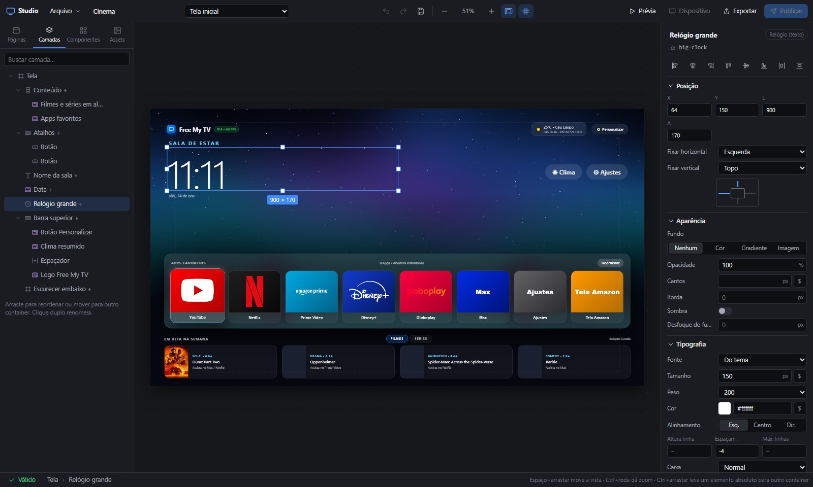
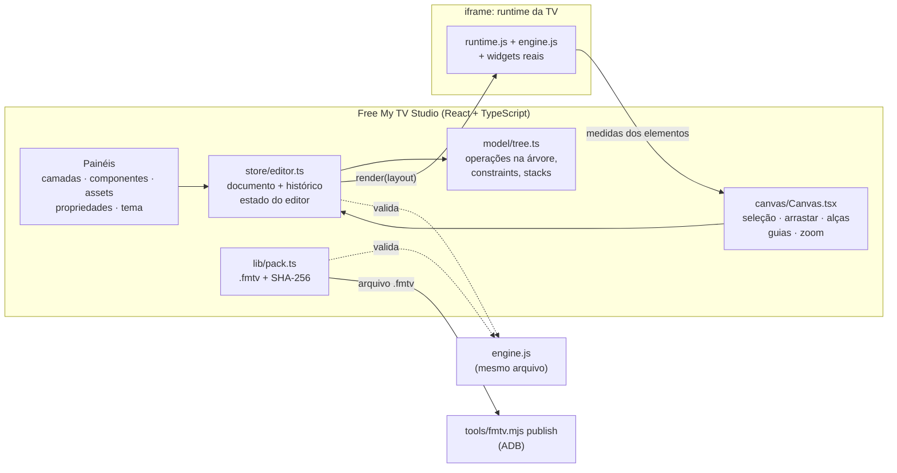
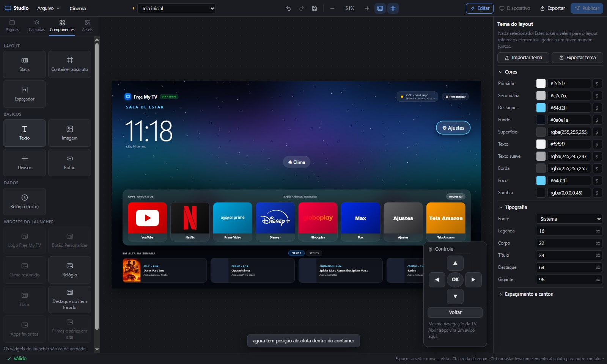
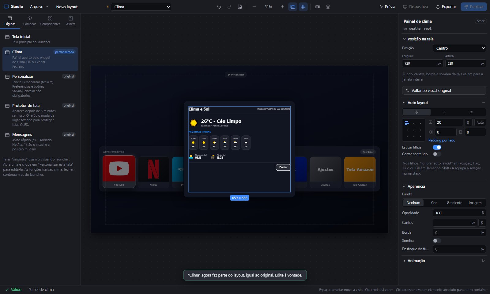
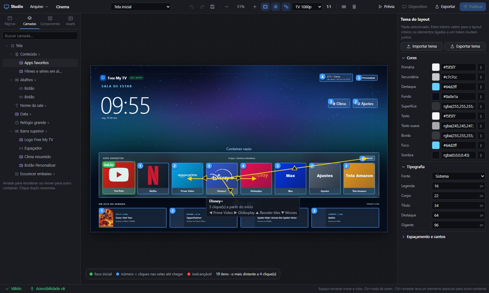

# Free My TV Studio

Editor visual para PC que cria e edita a tela inicial do Free My TV. Ele gera layouts no [formato schema v1](../docs/layouts.md), que o app do Fire TV aplica sem precisar recompilar.

> **Status: Fases 3 a 6 do roadmap.** Edição visual, auto layout, posicionamento absoluto, drag and drop, desfazer/refazer, projetos, exportação, mapa de foco, alertas de acessibilidade e prévia por resolução já funcionam. A publicação direta no Fire TV pelo Studio (Fases 7 e 8) ainda não existe: por enquanto exporte o `.fmtv` e publique com a CLI (`node tools/fmtv.mjs publish`).



## O canvas é o próprio runtime da TV

O canvas não é uma imitação da tela da TV. Ele carrega **a mesma página que o APK usa** (`app/src/main/assets/web`), com o mesmo `engine.js` e o mesmo `runtime.js`, num iframe. Por cima vai uma camada de edição (seleção, alças, guias). Por isso:

- o que aparece no editor é o que a TV desenha, inclusive os widgets reais (clima ao vivo, prateleira de apps, filmes em alta);
- a validação usa as mesmas regras da TV e da CLI;
- a **Prévia** usa a mesma navegação espacial do controle remoto.



## O que dá para fazer

| Área | Recursos |
|---|---|
| **Canvas** | Tela 1920×1080; zoom com Ctrl+roda ou pelos botões; mover a vista com espaço+arrastar ou o botão do meio; "ajustar à tela"; área segura da TV (90%); medidas do elemento selecionado |
| **Seleção** | Clique; Shift+clique para seleção múltipla; Esc limpa; caminho do elemento na barra inferior |
| **Posição absoluta** | Arrastar com **guias inteligentes** (bordas e centros do container e dos irmãos) ou grade de 8 px (Alt solta livre); setas movem 1 px, Shift+setas 10 px; **8 alças** de redimensionar (Shift mantém a proporção); X/Y/L/A numéricos; largura e altura **Fixo / Hug / Fill / percentual** sem mover o elemento; **constraints** (esquerda, direita, centro, esticar, escala) que mudam sem mover o elemento |
| **Auto layout** (no estilo do Figma) | Direção vertical, horizontal ou com quebra de linha; **grade 3×3 de alinhamento**; espaçamento com opção **Auto** (espaço entre); padding por eixo ou por lado; esticar filhos; linha de base; cortar conteúdo; **adicionar e remover auto layout** (Shift+A) mantendo o visual, com direção, espaçamento e padding deduzidos das posições e o que estava esticado virando **Fill**; filhos com **Fixo / Hug / Fill** ou percentual e mín./máx. (a seção **Redimensionamento** aparece logo abaixo do nome, antes do auto layout); stacks criadas a partir da seleção começam em **Hug**; **"Ignorar auto layout"**; arrastar reordena com **indicador de inserção**; stacks vazias aparecem com contorno tracejado |
| **Entre modos** | Levar um elemento de uma stack para um container absoluto (ou o contrário) mantendo o lugar; "No fluxo"/"Absoluto" dentro de stacks; o Studio avisa quando a mudança de modo altera algo |
| **Organizar** | Duplicar, copiar, recortar, colar, excluir, criar stack a partir da seleção (Ctrl+G / Ctrl+Alt+G), desagrupar (Ctrl+Shift+G), trazer para frente ou enviar para trás, alinhar e distribuir, ocultar, bloquear; menu de contexto |
| **Camadas** | Árvore com busca, expandir e recolher, renomear (duplo clique), ocultar, bloquear e arrastar para reordenar ou trocar de container |
| **Componentes** | Stack horizontal e vertical (também na barra superior), container absoluto, espaçador, texto, imagem, divisor, botão (com ações), ícone (seletor visual), relógio, **carrossel**, **grade**, **banner de destaque**, **clima completo** e os 8 widgets reais do launcher; clique para adicionar ou arraste para o canvas |
| **Blocos prontos** | Filmes em alta, Séries em alta, Aplicativos instalados, Apps favoritos, Banner, Clima completo, Cabeçalho com relógio, atalhos para Configurações e Tela Amazon, Gradiente e fundos (Aurora, Pôr do sol, Preto OLED) |
| **Meus blocos** | "Salvar como bloco" (botão direito) guarda um elemento para reutilizar; os blocos ficam no projeto, podem ser renomeados e excluídos e são inseridos como cópias |
| **Assets** | Importar PNG, JPG ou WebP (até 8 MB), miniaturas, usar como fundo, arrastar para o canvas |
| **Propriedades** | Layout, posição, tamanho, aparência (cor, gradiente com até 8 paradas, imagem, opacidade, cantos, borda, sombra, desfoque), tipografia, conteúdo e ações, foco do controle, animações (entrada e foco, com botão de reproduzir) |
| **Tema** | Tokens de cor, fonte e tamanhos, espaçamento e cantos; elementos ligados a um token (`$colors.accent`) acompanham as mudanças; importar e exportar tema |
| **Todas as telas** | Aba Páginas e seletor no topo: tela inicial, Clima, Personalizar, Protetor de tela e Mensagens. Cada tela é mostrada aberta no canvas, com o runtime da TV. "Personalizar esta tela" parte do original, sem mudar nada até você editar. "Posição na tela" define a posição e o tamanho da janela. Widgets reais de cada tela na biblioteca; os obrigatórios são protegidos (o aviso aparece na hora). "Voltar ao visual original" desfaz a personalização da tela |
| **Prévia** | Tecla P; navegação pelas setas igual à da TV e controle remoto virtual; Esc volta a editar |
| **Mapa de foco** | Tecla F ou o botão na barra de cima. Cada item que o controle alcança ganha um quadro com o **número de cliques nas setas** a partir do foco inicial (verde); o que as setas **nunca alcançam** fica em vermelho. Passar o mouse num item mostra para onde cada seta leva dali. Usa a mesma regra de navegação da TV (`pickNext` do `engine.js`), então mostra também os caminhos que o launcher cria, como a seta para cima da prateleira indo ao botão "Reorder". Vale para a tela inicial; as outras telas usam a navegação do próprio launcher |
| **Acessibilidade** | Alertas na barra de baixo, separados dos erros (não impedem exportar); clicar seleciona o elemento. **Foco:** itens inalcançáveis. **Contraste** (WCAG: 4,5:1, ou 3:1 para texto grande) do texto, botão e relógio, medido no runtime com o que está realmente pintado atrás, inclusive gradientes, fundos semitransparentes e elementos irmãos; sobre uma foto, o texto precisa passar tanto com a foto preta quanto branca, ou ter sombra. **Tamanho do texto:** menos de 16 px é pequeno para ler do sofá. **Bordas:** texto ou item navegável na faixa que TVs com overscan cortam (48 px nas laterais, 27 px em cima e embaixo; o tracejado de 90% continua como margem recomendada) |
| **Resolução da TV** | Seletor 720p, 1080p ou 4K. O layout tem sempre 1920×1080 e a TV só muda a escala, então as proporções não mudam: o que muda é a nitidez. Em 720p, o Studio avisa texto que fica com menos de 12 px reais e linhas que ficam com menos de 1 px real. **1:1** (Shift+0) mostra o canvas no tamanho real, com 1 pixel da TV para cada pixel da sua tela |
| **Projetos** | Modelos (em branco, Clássico, Cinema); abrir e salvar `.fmtvproj` (Ctrl+O, Ctrl+S, Ctrl+Shift+S); abre também um `layout.json`; **autosave** com recuperação depois de uma falha; aviso ao fechar com alterações |
| **Exportar** | Pacote `.fmtv` para a TV (validação rigorosa, só as imagens usadas, SHA-256) ou `layout.json` |
| **Problemas** | Erros e avisos do validador na barra inferior; clicar seleciona o elemento |

<table>
<tr>
<td width="50%"><br><sub>Stack "Atalhos" selecionada: auto layout, posição com constraints e camadas.</sub></td>
<td width="50%"><br><sub>Prévia: foco no botão "Ajustes" depois de navegar pelas setas, controle virtual e o tema do layout.</sub></td>
</tr>
</table>



<sub>Tela de clima personalizada: painel centralizado de 720 px, com os widgets reais do launcher e "Posição na tela".</sub>



<sub>Mapa de foco no modelo Cinema: o foco começa no YouTube, cada número é a quantidade de cliques nas setas até o item, e o mouse sobre o Disney+ mostra para onde cada seta leva.</sub>

## Rodar

Requisitos: Node 18+.

```
cd studio
npm install
npm run dev            # abre em http://127.0.0.1:5610 (Chrome ou Edge)
```

### Como aplicativo desktop (Tauri)

Requisitos adicionais: [Rust](https://rustup.rs) e, no Windows, o Visual Studio Build Tools com o componente C++ (MSVC). O WebView2 já vem no Windows 10 e 11.

```
npm run desktop          # janela nativa com recarga automática
npm run desktop:build    # gera o instalador em src-tauri/target/release/bundle/nsis/
```

## Testes

```
npm test                 # 57 testes: árvore, constraints, stacks, auto layout, blocos, telas, histórico, arquivos, pacote, contraste, foco
npm run dev              # em outro terminal
npm run e2e              # 60 verificações no Chrome de verdade, com mouse e teclado
```

O teste ponta a ponta usa eventos reais de mouse e teclado em quatro roteiros: o modelo Cinema, o modelo Em branco com auto layout na Tela, as outras telas (Clima, Personalizar, protetor e mensagens) e o mapa de foco com os alertas. No último, ele monta de propósito um botão escondido atrás de outro, um texto cinza-escuro de 12 px colado na borda e um texto de 17 px em 720p, e confere que cada alerta aparece e some quando deve. No modelo Cinema ele:
- seleciona, arrasta e redimensiona;
- desfaz e refaz;
- reordena dentro de uma stack e tira um elemento da stack;
- adiciona um texto pela biblioteca e o edita no painel, conferindo que o **runtime da TV** dentro do canvas mostra o texto novo;
- exclui o elemento e confere que o documento continua válido;
- navega na Prévia pelas setas;
- confirma que não houve nenhum erro de JavaScript.

Em desenvolvimento, o canvas usa o runtime da TV **direto** de `app/src/main/assets/web`, sempre atualizado. Só o build copia os arquivos para `public/runtime`.

Quando uma mudança deixa o layout inválido, o Studio avisa na hora. O canvas continua mostrando a última versão válida até a correção, e os erros aparecem na barra de baixo.

## Estrutura

```
studio/
  src/engine.ts            carrega app/.../fmtv/engine.js (o mesmo da TV)
  src/model/types.ts       tipos do schema v1 e do projeto
  src/model/tree.ts        operações puras: mover, agrupar, constraints, alinhar
  src/model/project.ts     modelos e formato .fmtvproj
  src/store/editor.ts      estado: documento com histórico x estado do editor
  src/canvas/              canvas e ponte com o iframe do runtime
  src/canvas/audit.ts      mapa de foco e alertas, lidos do runtime da TV
  src/model/a11y.ts        contraste (WCAG), grafo de foco, área segura, resoluções
  src/panels/              camadas, componentes, assets, propriedades, tema, problemas
  src/lib/                 pacote .fmtv, bytes/zip/SHA-256, abrir/salvar/autosave
  scripts/copy-runtime.mjs copia a página da TV para public/runtime (prévia)
  scripts/e2e.mjs          teste ponta a ponta via Chrome DevTools Protocol
  src-tauri/               casca desktop (Tauri 2)
```

**Documento e editor ficam separados.** O que é salvo, exportado e desfeito (`project`) nunca mistura seleção, zoom ou medidas. Toda mudança no documento passa por `commit`, que registra o histórico e agrupa digitação rápida num passo só. O arquivo de projeto contém apenas o layout e as imagens, sem credenciais.

## Limitações desta fase

- **Publicar** e **Dispositivo** ficam desativados até as Fases 7 (ADB) e 8 (internet). Use **Exportar → Pacote (.fmtv)** e a CLI.
- O teste ponta a ponta roda no Chrome; o app desktop usa o WebView2, que é do mesmo motor, mas não tem teste automático próprio.
- **Contraste:** é medido no texto, nos botões e no relógio que o layout desenha. Os widgets do launcher e os pôsteres dos carrosséis ficam de fora. Uma sombra no texto sobre uma foto conta como suficiente, sem medir a força da sombra.
- **Resolução:** o **1:1** mostra o tamanho real em pixels, mas quem desenha é o Chrome do PC, com a renderização de fonte dele; não é uma simulação do WebView da TV.
- **Mapa de foco:** mostra as posições no início, como a TV calcula ao abrir. Dentro de um carrossel os cartões rolam conforme o foco anda, e o mapa não acompanha essa rolagem.
