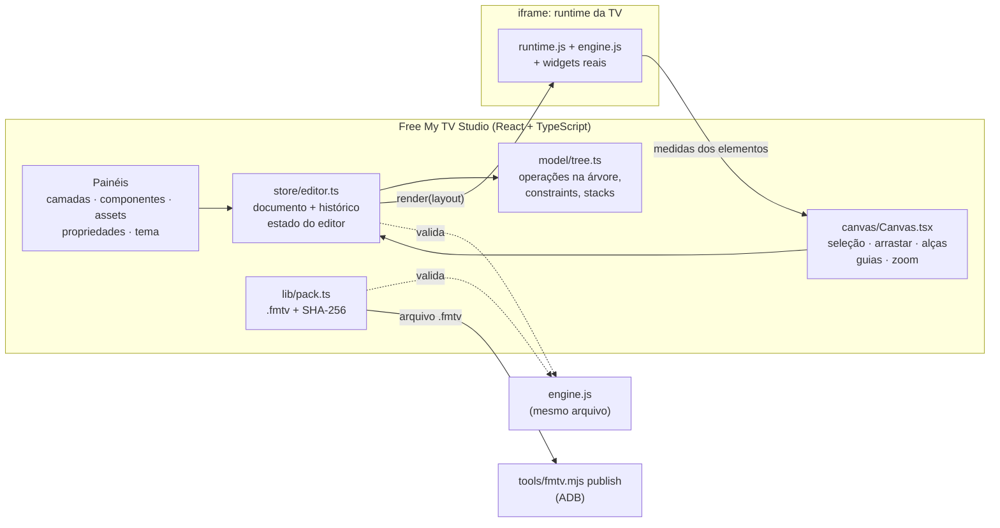
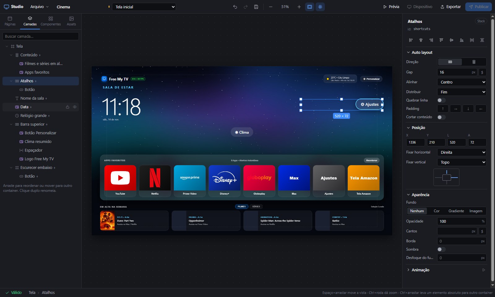

# Free My TV Studio

Editor visual para PC que cria e edita a tela inicial do Free My TV. Ele gera layouts no [formato schema v1](../docs/layouts.md), que o app do Fire TV aplica sem precisar recompilar.

> **Status: Fase 3 do roadmap.** Edição visual, auto layout, posicionamento absoluto, drag and drop, desfazer/refazer, projetos e exportação já funcionam. A publicação direta no Fire TV pelo Studio (Fases 7 e 8) ainda não existe: por enquanto exporte o `.fmtv` e publique com a CLI (`node tools/fmtv.mjs publish`).


## O canvas é o próprio runtime da TV

O canvas não é uma imitação da tela da TV. Ele carrega **a mesma página que o APK usa** (`app/src/main/assets/web`), com o mesmo `engine.js` e o mesmo `runtime.js`, num iframe. Por cima vai uma camada de edição (seleção, alças, guias). Por isso:

- o que aparece no editor é o que a TV desenha, inclusive os widgets reais (clima ao vivo, prateleira de apps, filmes em alta);
- a validação usa as mesmas regras da TV e da CLI;
- a **Prévia** usa a mesma navegação espacial do controle remoto.



## O que dá para fazer

| Área | Recursos |
|---|---|
| **Canvas** | Tela 1920×1080; zoom com Ctrl+roda ou pelos botões; mover a vista com espaço+arrastar ou o botão do meio; "ajustar à tela"; área segura da TV (90%); medidas do elemento selecionado |
| **Seleção** | Clique; Shift+clique para seleção múltipla; Esc limpa; caminho do elemento na barra inferior |
| **Posição absoluta** | Arrastar com **guias inteligentes** (bordas e centros do container e dos irmãos) ou grade de 8 px (Alt solta livre); setas movem 1 px, Shift+setas 10 px; **8 alças** de redimensionar (Shift mantém a proporção); X/Y/L/A numéricos; **constraints** (esquerda, direita, centro, esticar, escala) que mudam sem mover o elemento |
| **Auto layout** | Stacks horizontais e verticais aninhadas; gap, padding individual, alinhar, distribuir, quebra de linha, cortar conteúdo; tamanho fixo, "ajustar ao conteúdo", "preencher" ou percentual; mín./máx.; arrastar reordena com **indicador de inserção** |
| **Entre modos** | Levar um elemento de uma stack para um container absoluto (ou o contrário) mantendo o lugar; "No fluxo"/"Absoluto" dentro de stacks; o Studio avisa quando a mudança de modo altera algo |
| **Organizar** | Duplicar, copiar, recortar, colar, excluir, criar stack a partir da seleção (Ctrl+G / Ctrl+Alt+G), desagrupar (Ctrl+Shift+G), trazer para frente ou enviar para trás, alinhar e distribuir, ocultar, bloquear; menu de contexto |
| **Camadas** | Árvore com busca, expandir e recolher, renomear (duplo clique), ocultar, bloquear e arrastar para reordenar ou trocar de container |
| **Componentes** | Stack, container absoluto, espaçador, texto, imagem, divisor, botão (com ações), relógio e os 8 widgets reais do launcher; clique para adicionar ou arraste para o canvas |
| **Assets** | Importar PNG, JPG ou WebP (até 8 MB), miniaturas, usar como fundo, arrastar para o canvas |
| **Propriedades** | Layout, posição, tamanho, aparência (cor, gradiente com até 8 paradas, imagem, opacidade, cantos, borda, sombra, desfoque), tipografia, conteúdo e ações, foco do controle, animações (entrada e foco, com botão de reproduzir) |
| **Tema** | Tokens de cor, fonte e tamanhos, espaçamento e cantos; elementos ligados a um token (`$colors.accent`) acompanham as mudanças; importar e exportar tema |
| **Prévia** | Tecla P; navegação pelas setas igual à da TV e controle remoto virtual; Esc volta a editar |
| **Projetos** | Modelos (em branco, Clássico, Cinema); abrir e salvar `.fmtvproj` (Ctrl+O, Ctrl+S, Ctrl+Shift+S); abre também um `layout.json`; **autosave** com recuperação depois de uma falha; aviso ao fechar com alterações |
| **Exportar** | Pacote `.fmtv` para a TV (validação rigorosa, só as imagens usadas, SHA-256) ou `layout.json` |
| **Problemas** | Erros e avisos do validador na barra inferior; clicar seleciona o elemento |

<table>
<tr>
<td width="50%"><br><sub>Stack "Atalhos" selecionada: auto layout, posição com constraints e camadas.</sub></td>
<td width="50%"><br><sub>Prévia: foco no botão "Ajustes" depois de navegar pelas setas, controle virtual e o tema do layout.</sub></td>
</tr>
</table>

## Rodar

Requisitos: Node 18+.

```
cd studio
npm install
npm run dev            # abre em http://127.0.0.1:5610 (Chrome ou Edge)
```

### Como aplicativo desktop (Tauri)

Requisitos adicionais: [Rust](https://rustup.rs) e, no Windows, o Visual Studio Build Tools com o componente C++ (MSVC). O WebView2 já vem no Windows 10 e 11.

```
npm run desktop          # janela nativa com recarga automática
npm run desktop:build    # gera o instalador em src-tauri/target/release/bundle/nsis/
```

## Testes

```
npm test                 # 26 testes: árvore, constraints, stacks, histórico, arquivos, pacote
npm run dev              # em outro terminal
npm run e2e              # 16 verificações no Chrome de verdade, com mouse e teclado
```

O teste ponta a ponta abre o Studio no modelo Cinema e, com eventos reais de mouse e teclado:
- seleciona, arrasta e redimensiona;
- desfaz e refaz;
- reordena dentro de uma stack e tira um elemento da stack;
- adiciona um texto pela biblioteca e o edita no painel, conferindo que o **runtime da TV** dentro do canvas mostra o texto novo;
- exclui o elemento e confere que o documento continua válido;
- navega na Prévia pelas setas;
- confirma que não houve nenhum erro de JavaScript.

## Estrutura

```
studio/
  src/engine.ts            carrega app/.../fmtv/engine.js (o mesmo da TV)
  src/model/types.ts       tipos do schema v1 e do projeto
  src/model/tree.ts        operações puras: mover, agrupar, constraints, alinhar
  src/model/project.ts     modelos e formato .fmtvproj
  src/store/editor.ts      estado: documento com histórico x estado do editor
  src/canvas/              canvas e ponte com o iframe do runtime
  src/panels/              camadas, componentes, assets, propriedades, tema, problemas
  src/lib/                 pacote .fmtv, bytes/zip/SHA-256, abrir/salvar/autosave
  scripts/copy-runtime.mjs copia a página da TV para public/runtime (prévia)
  scripts/e2e.mjs          teste ponta a ponta via Chrome DevTools Protocol
  src-tauri/               casca desktop (Tauri 2)
```

**Documento e editor ficam separados.** O que é salvo, exportado e desfeito (`project`) nunca mistura seleção, zoom ou medidas. Toda mudança no documento passa por `commit`, que registra o histórico e agrupa digitação rápida num passo só. O arquivo de projeto contém apenas o layout e as imagens, sem credenciais.

## Limitações desta fase

- **Só a tela inicial é editável.** As outras telas entram com a Fase 5, junto com o suporte no runtime da TV.
- **Publicar** e **Dispositivo** ficam desativados até as Fases 7 (ADB) e 8 (internet). Use **Exportar → Pacote (.fmtv)** e a CLI.
- O teste ponta a ponta roda no Chrome; o app desktop usa o WebView2, que é do mesmo motor, mas não tem teste automático próprio.
